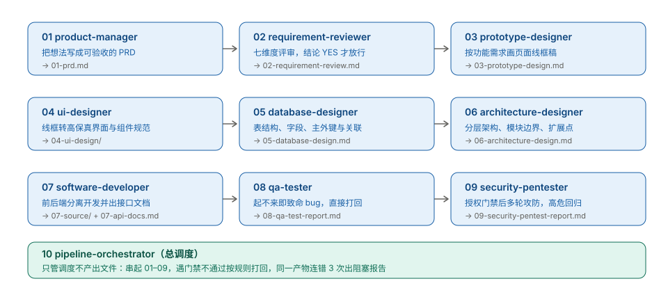
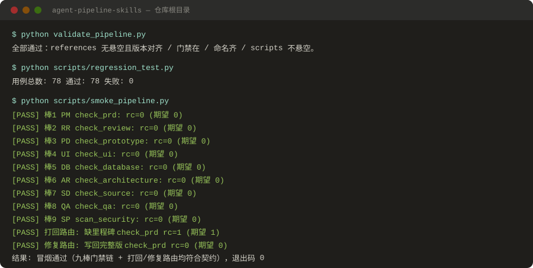

# 软件开发流水线技能包

**把「写需求 → 评审 → 设计 → 开发 → 测试 → 安全」拆成 10 个 Agent Skill，每棒交稿前必须跑脚本过门禁，缺东西直接非 0 退出。给用 AI 写完整项目的人用。**

[](https://github.com/zhanguoliang715/agent-pipeline-skills/actions/workflows/pipeline-ci.yml)




## 它解决什么问题

让 AI 写一个能跑的 Demo 很容易，写一个能交付的项目很难。难的不是写代码，是每一步之间的交接：

- PRD 里没写验收标准，开发照样开工，做完才发现做的不是想要的；
- 设计文档缺失，代码结构一开始就是歪的，加第二个功能就得重构；
- 代码写完没人测，"应该没问题"上生产；
- 安全扫描走了个形式，扫完没人修；
- 被打回的结论散在聊天记录里，下一棒自己猜。

这套技能包的做法很土但有效：**九棒各管一段，产物文件名写死（`01-prd.md` 到 `09-security-pentest-report.md`），每棒交稿前跑一个校验脚本，退出码非 0 不许往下流。** 交接不靠口头，靠文件在不在、章节全不全、结论是 YES 还是 NO。

## 实际运行（原文照录，未改写）



78 个回归用例、九棒门禁链、打回与修复路由，全部由脚本断言，不是手写结论。

## 30 秒上手

不需要装任何东西，八个校验脚本只用 Python 标准库：

```bash
git clone https://github.com/zhanguoliang715/agent-pipeline-skills.git
cd agent-pipeline-skills
python validate_pipeline.py          # 结构一致性
python scripts/regression_test.py    # 退出码契约（78 例）
python scripts/smoke_pipeline.py     # 端到端冒烟
```

三条命令都退出 0 = 仓库是健康的。之后在一个空工作目录里，让 Agent 按 `docs/新手手册/` 的顺序逐棒干活即可，产物会自动排成 `01-` 到 `09-`。

## 九棒分工

| 棒 | 技能 | 产出 | 门禁（不过就不开工 / 不往下流） |
|---|---|---|---|
| 1 | `product-manager` | `01-prd.md` | 第 0 步先确认真要做，最多 3 轮追问 |
| 2 | `requirement-reviewer` | `02-requirement-review.md` | 结论非 YES 不开工；最多打回 2 次 |
| 3 | `prototype-designer` | `03-prototype-design.md` | 02 不是 YES 不画 |
| 4 | `ui-designer` | `04-ui-design/` | 原型缺失或未放行不画 |
| 5 | `database-designer` | `05-database-design.md` | 02 不是 YES 不设计 |
| 6 | `architecture-designer` | `06-architecture-design.md` | 无 FR 清单、或 05 未定稿不设计 |
| 7 | `software-developer` | `07-source/` + `07-api-docs.md` | 02 非 YES 或设计不齐不写 |
| 8 | `qa-tester` | `08-qa-test-report.md` | 按 README 起不来 = 致命 bug 直接打回 |
| 9 | `security-pentester` | `09-security-pentest-report.md` | 外部 / 公网目标一律拒绝 |
| 10 | `pipeline-orchestrator` | 不产出文件 | 只调度：串棒、打回、连错 3 次出阻塞报告 |

## 文档

| 想看什么 | 去哪 |
|---|---|
| 第一次用，从哪开始 | [docs/新手手册/](docs/新手手册/) — 每棒一份，讲清"它是什么、为什么要它、怎么做、做错会怎样" |
| 要改技能、要知道边界 | [docs/技术文档/](docs/技术文档/) — 每棒一份，讲清输入输出契约、限制、优缺点、失败模式 |
| 完整规则与退出码表 | [USAGE.md](USAGE.md) |
| 早期手记（命令以 README 为准） | [docs/快速上手.txt](docs/快速上手.txt) |
| 版本变更 | [CHANGELOG.md](CHANGELOG.md) |

## 它是什么，不是什么

- **是**：一套给 Agent 读的作业规程，配机器可判的门禁脚本。人也能照着用。
- **是**：单棒可拆。九个单棒目录各自自包含，拷走 `SKILL.md` + `references/` + `scripts/` 就能单独跑，不需要整套仓库。
- **不是**通用技能。它假定你做的是**有前后端、要交付的中小型 Web 项目**。换成纯算法库、数据分析脚本、嵌入式固件，架构分层与安全攻防这两棒就不适用，硬套只会产出没人看的文档。
- **不是**代码生成器。它约束流程，不替你写业务逻辑。
- **不替你判断值不值得做**。第 1 棒只追问到"边界清楚"为止，商业判断仍是你的事。

## 目录

```
agent-pipeline-skills/
├── <10 个技能目录>/      # 每个含 SKILL.md + references/ + scripts/
├── scripts/              # 仓库级：回归测试 + 端到端冒烟
├── docs/                 # 新手手册 / 技术文档 / 图 / Pages 首页
├── .github/              # CI + Issue 模板 + PR 模板
├── validate_pipeline.py  # 全流水线一致性校验
├── USAGE.md              # 详细规则
└── CHANGELOG.md          # 变更记录
```

## 环境

Python ≥ 3.9，零第三方依赖。安全棒可选深度扫描：`pip install "bandit==1.9.4"`（不装也能跑，只做正则粗扫）。

## License

[MIT](LICENSE)
